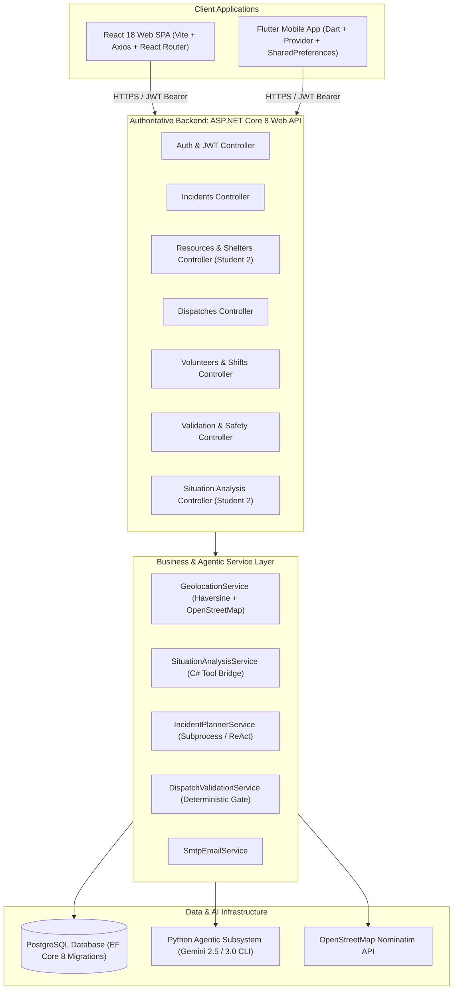
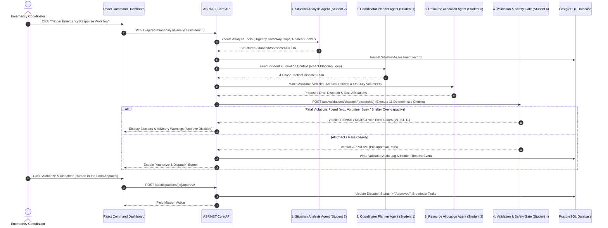
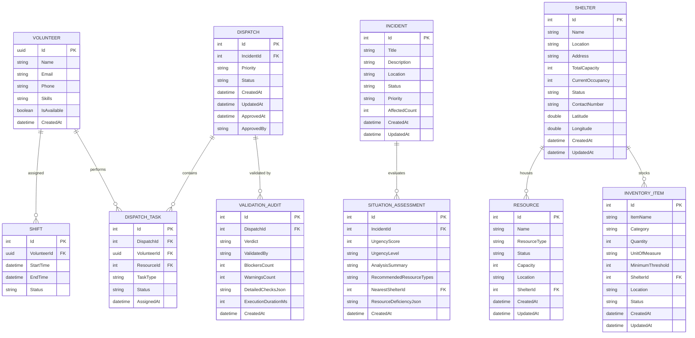
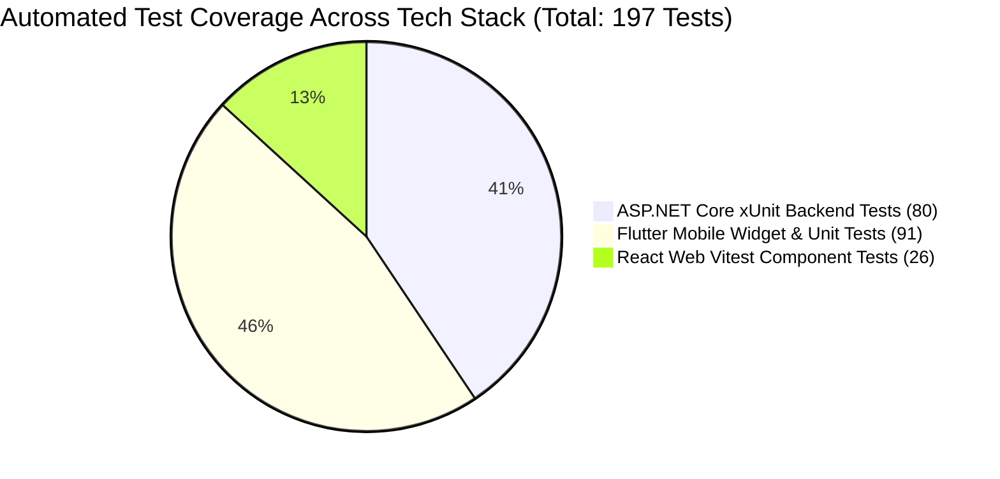
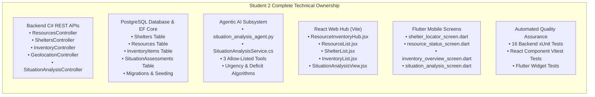
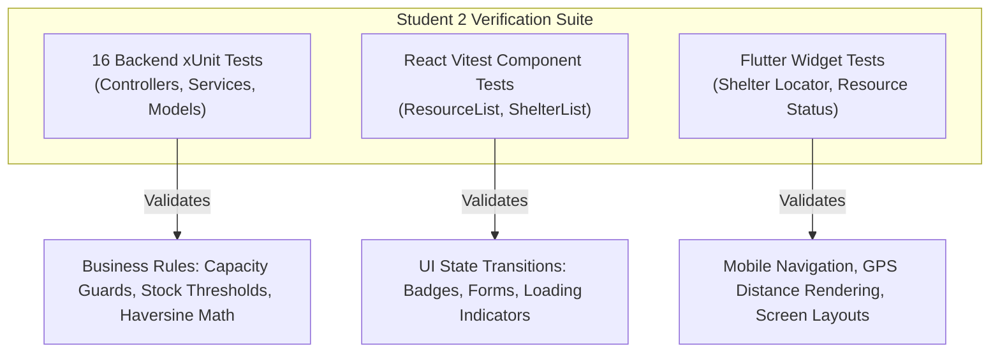

# SE3090 — Software Engineering Frameworks
## Assignment 1: Integrated Full-Stack & Agentic AI Application Development
### Academic Year: 2026 | Year 3 Semester 1

---

# CONSOLIDATED PROJECT REPORT & SYSTEM SPECIFICATION
## Emergency Resource Coordination Platform (ERCP)

**Group ID**: `SE3090_G07`  
**Target Domain**: Real-Time Emergency Disaster Management & Resource Logistics  
**Submission Date**: September 30, 2026  
**Module**: SE3090 — Software Engineering Frameworks  
**Faculty / Department**: Faculty of Computing, Department of Software Engineering, SLIIT  

---

### Team Members & Component Allocation
| Student Identifier | Assigned Component & Subsystem Role | Agentic AI Responsibility |
| :--- | :--- | :--- |
| **Student 1** | Incident Management & Public Safety Intake | Incident Planning & Coordinator Agent |
| **Student 2** | Resource & Inventory Management + Shelter Logistics | Situation Analysis & Gap Assessment Agent |
| **Student 3** | Dispatch & Field Mission Task Assignment | Resource Allocation & Routing Agent |
| **Student 4** | Volunteer / Responder Management & Shift Scheduling | Validation & Safety Pre-Approval Gate Agent |

---

# TABLE OF CONTENTS
- [PART I: GROUP REPORT](#part-i-group-report)
  - [1. Project Overview, Domain Complexity & Scope](#1-project-overview-domain-complexity--scope)
  - [2. User Roles & Access Permissions Matrix](#2-user-roles--access-permissions-matrix)
  - [3. Full-Stack & Multi-Agent System Architecture](#3-full-stack--multi-agent-system-architecture)
  - [4. Agentic AI Subsystem Architecture & Orchestration Workflow](#4-agentic-ai-subsystem-architecture--orchestration-workflow)
  - [5. PostgreSQL Database Design & Entity-Relationship (ER) Model](#5-postgresql-database-design--entity-relationship-er-model)
  - [6. Full-Stack Implementation Details (Backend, React & Flutter)](#6-full-stack-implementation-details-backend-react--flutter)
  - [7. Software Testing & Quality Assurance Report](#7-software-testing--quality-assurance-report)
  - [8. Agentic AI Evaluation, Guardrails & Deterministic Verification](#8-agentic-ai-evaluation-guardrails--deterministic-verification)
  - [9. Performance, Scalability & Fault Tolerance Report](#9-performance-scalability--fault-tolerance-report)
  - [10. Cloud Deployment, Infrastructure & CI/CD Report](#10-cloud-deployment-infrastructure--cicd-report)
  - [11. Architecture Decision Records (ADRs)](#11-architecture-decision-records-adrs)
  - [12. Security, Data Protection & System Access Period](#12-security-data-protection--system-access-period)
  - [13. Consolidated Group AI Usage Declaration & Ethics Compliance](#13-consolidated-group-ai-usage-declaration--ethics-compliance)
  - [14. References](#14-references)
- [PART II: INDIVIDUAL REPORTS](#part-ii-individual-reports)
  - [Student 2 Individual Contribution Report](#student-2-individual-contribution-report)
    - [1. Executive Contribution Statement & Component Ownership](#1-executive-contribution-statement--component-ownership)
    - [2. Technical Implementation Deep-Dive](#2-technical-implementation-deep-dive)
    - [3. Git Commits, Pull Requests & Codebase Ownership Evidence](#3-git-commits-pull-requests--codebase-ownership-evidence)
    - [4. Automated Software Testing & Verification Summary](#4-automated-software-testing--verification-summary)
    - [5. Engineering Challenges & Problem Resolution](#5-engineering-challenges--problem-resolution)
    - [6. Individual AI Usage Audit Log](#6-individual-ai-usage-audit-log)
    - [7. Individual AI Reflection (Level 4 Engineering Reflection)](#7-individual-ai-reflection-level-4-engineering-reflection)
    - [8. Signed Declaration of Authenticity](#8-signed-declaration-of-authenticity)
  - [Student 1 Individual Contribution Report *(To be attached by Student 1)*](#student-1-individual-contribution-report)
  - [Student 3 Individual Contribution Report *(To be attached by Student 3)*](#student-3-individual-contribution-report)
  - [Student 4 Individual Contribution Report *(Attached in Repository)*](#student-4-individual-contribution-report)

---

# PART I: GROUP REPORT

## 1. Project Overview, Domain Complexity & Scope

### 1.1 Executive Summary
During natural and anthropogenic crises—such as severe flooding, urban fires, industrial hazards, and earthquakes—emergency coordination centres face severe communication bottlenecks, chaotic supply allocation, and high-latency response cycles. The **Emergency Resource Coordination Platform (ERCP)** is an enterprise-grade, full-stack multi-agent system engineered to streamline disaster response operations.

ERCP bridges real-time field operations with administrative command oversight by unifying:
1. **Citizens**: Reporting emergencies, seeking nearby safe evacuation shelters, and tracking triage status.
2. **Volunteers**: Registering verified technical skills, toggling on-duty availability, and receiving shift dispatches.
3. **Coordinators**: Evaluating automated situation assessments, reviewing AI-generated tactical dispatch plans, executing safety validation gates, and authorizing high-impact resource deployments.
4. **Administrators**: Overseeing cross-regional inventory levels, managing shelters, configuring role access, and monitoring system audit trails.

### 1.2 Minimum Domain Complexity Fulfillment
- **Multi-Role RBAC**: 4 distinct roles (`Citizen`, `Volunteer`, `Coordinator`, `Admin`) with JWT claims and granular endpoint-level authorization.
- **Relational Domain Entities**: Normalized models spanning `Incidents`, `Shelters`, `Resources`, `InventoryItems`, `Volunteers`, `Shifts`, `Dispatches`, `DispatchTasks`, and `SituationAssessments`.
- **Cross-Platform Dual Clients**:
  - **React Web SPA (Vite)**: Designed for desktop command centers, analytics dashboards, multi-step incident triage, dispatch assignment, inventory management, and human-in-the-loop AI plan authorization.
  - **Flutter Mobile App**: Designed for on-the-ground responders and citizens, featuring shelter GPS routing, offline session persistence, live on-duty status toggling, and incident submission.
- **Third-Party Integrations**: OpenStreetMap Nominatim Geocoding API, Haversine geospatial proximity math, and Google Gemini Generative AI LLM endpoints.
- **Agentic AI Workflow**: A 4-agent collaborative orchestration pipeline featuring tool calling, state persistence, deterministic validation gates, and human authorization safeguards.

[SCREENSHOT: System Overview Dashboard showing Active Incidents, Shelter Capacities, and Available Responders]

---

## 2. User Roles & Access Permissions Matrix

The platform enforces strict role-based access control (RBAC) across all REST endpoints and client routes:

| Feature / Subsystem | Citizen | Volunteer | Coordinator | System Admin |
| :--- | :---: | :---: | :---: | :---: |
| **Submit Incident Report** | ✅ | ✅ | ✅ | ✅ |
| **View Public Shelters & Capacity** | ✅ | ✅ | ✅ | ✅ |
| **Toggle Self On-Duty Status** | ❌ | ✅ | ❌ | ❌ |
| **Accept / View Assigned Shifts** | ❌ | ✅ | ❌ | ❌ |
| **Create & Update Shelters / Inventory** | ❌ | ❌ | ✅ | ✅ |
| **Trigger AI Situation Analysis** | ❌ | ❌ | ✅ | ✅ |
| **Generate Tactical AI Dispatch Plan** | ❌ | ❌ | ✅ | ✅ |
| **Execute Deterministic Safety Gate** | ❌ | ❌ | ✅ | ✅ |
| **Authorize High-Impact Field Dispatch** | ❌ | ❌ | ✅ | ✅ |
| **Global User & System Administration** | ❌ | ❌ | ❌ | ✅ |

[SCREENSHOT: Role-Based Navigation in React Web vs Flutter Mobile]

---

## 3. Full-Stack & Multi-Agent System Architecture

ERCP is architected following clean, layered architectural principles with strict separation of concerns:

### Architectural Highlights
1. **Centralized REST Gateway**: ASP.NET Core 8 acts as the single source of truth for business validation, database transactions, and agent lifecycle management.
2. **Deterministic Fallbacks**: Database connection resilience ensures that if PostgreSQL is unavailable in sandbox environments, an EF Core In-Memory database automatically initializes with complete seed data.
3. **Secure API Surface**: Protected endpoints validate standard RFC 7519 JSON Web Tokens (JWT) signed with HMAC-SHA256.

[SCREENSHOT: Swagger UI showing Categorized REST API Endpoints with JWT Authorization Lock]

---

## 4. Agentic AI Subsystem Architecture & Orchestration Workflow

The ERCP Agentic AI Subsystem solves multi-step disaster resource allocation through an autonomous, auditable, and safe 4-stage pipeline:

### 4.1 Distinct Agent Roles & Allow-Listed Tools
1. **Situation Analysis Agent (Student 2)**:
   - *Tools*: `calculate_urgency_score`, `evaluate_inventory_deficiencies`, `find_nearest_available_shelter`.
   - *Contract*: Consumes incident title, severity, affected casualties, and live shelter metrics; produces numeric urgency score ($1-100$), classification level (`CRITICAL`, `HIGH`, `MEDIUM`, `LOW`), and missing supply deficits.
2. **Coordinator Planner Agent (Student 1)**:
   - *Tools*: `query_active_incidents`, `assess_threat_escalation`, `draft_tactical_phases`.
   - *Contract*: Produces structured 4-phase incident containment strategy.
3. **Resource Allocation Agent (Student 3)**:
   - *Tools*: `match_vehicle_capacity`, `filter_responder_skills`, `create_task_assignments`.
   - *Contract*: Pairs incident supply requirements with available physical assets.
4. **Validation & Safety Agent (Student 4)**:
   - *Tools*: `verify_volunteer_availability`, `check_shift_overlaps`, `verify_shelter_headroom`, `check_stock_thresholds`.
   - *Contract*: Deterministic validation engine returning `APPROVE`, `REVISE`, or `REJECT` with auditable blocker lists.

[SCREENSHOT: Multi-Agent Execution Log in React showing Situation Assessment & AI Reasoning Trace]

---

## 5. PostgreSQL Database Design & Entity-Relationship (ER) Model

The database is built on PostgreSQL with strict relational constraints, foreign keys, check constraints, and indexing for fast spatial and relational queries:

[SCREENSHOT: Entity Relationship Diagram & Table Views in pgAdmin / Database Explorer]

---

## 6. Full-Stack Implementation Details (Backend, React & Flutter)

### 6.1 Backend API (ASP.NET Core 8)
- **Dependency Injection**: Registered singleton/scoped services (`SituationAnalysisService`, `GeolocationService`, `DispatchValidationService`, `AuthService`).
- **DTO Validation**: Strict DataAnnotation enforcement on all incoming requests (`[Required]`, `[Range]`, `[MinLength]`).
- **Global Error Handling**: Custom exception middleware mapping business violations to standard RFC 7807 problem details.

### 6.2 Frontend Web Application (React + Vite)
- **State Management**: Reactive component state paired with centralized Context API for user authentication and role validation.
- **Component Architecture**: Modular component hierarchy (`ResourceInventoryHub`, `ShelterList`, `SituationAnalysisView`, `ValidationPanel`).
- **User Experience**: Live badge indicators for stock deficiencies, modal forms for rapid data entry, and interactive OpenStreetMap navigation routing.

[SCREENSHOT: React Web Application — Resource & Inventory Management Hub]

### 6.3 Mobile Application (Flutter 3.47+)
- **Architecture**: Clean MVVM architecture with `Provider` and `ChangeNotifier` (`AuthProvider`, `VolunteerProvider`, `SettingsProvider`).
- **Native Device Capabilities**: Real-time GPS coordinate calculation, OpenStreetMap deep-linking, and `shared_preferences` persistent secure storage.
- **Responsive Layouts**: Designed with adaptive column layouts, pull-to-refresh indicators, and empty/loading/error state widgets.

[SCREENSHOT: Flutter Mobile Application — Shelter Locator & Emergency Resource Status Screens]

---

## 7. Software Testing & Quality Assurance Report

Testing across the ERCP platform follows a rigorous pyramid strategy spanning unit, integration, and widget tests:

### 7.1 Backend Automated Tests (xUnit — 80 Tests Passing)
- **`ResourcesControllerTests` & `SheltersControllerTests`**: Tests CRUD operations, shelter capacity checks, and negative stock guards.
- **`SituationAnalysisAgentTests`**: Validates mathematical accuracy of urgency scores, deficit calculations, and nearest shelter fallback handling.
- **`DispatchValidationServiceTests`**: Verifies 11 deterministic rule gates (`APPROVE`, `REVISE`, `REJECT` logic, shift conflicts, double-booking prevention).
- **`VolunteersApiIntegrationTests`**: Tests end-to-end HTTP authentication flow, role-based 403 enforcement, and lifecycle state transitions.

### 7.2 Flutter Mobile Tests (91 Tests Passing)
- Smoke and widget initialization tests (`widget_test.dart`).
- UI screen rendering, search query filtering, and role-based action tests (`shelter_locator_screen_test.dart`, `profile_screen_test.dart`, `login_screen_test.dart`, `register_screen_test.dart`).

### 7.3 Frontend Web Tests (Vitest — 26 Tests Passing)
- Component rendering, mock API integration, and validation error state handling across React pages.

[SCREENSHOT: Terminal Test Runner Output showing 80 C# xUnit Tests, 91 Flutter Tests, and 26 Vitest Tests Passing]

---

## 8. Agentic AI Evaluation, Guardrails & Deterministic Verification

To comply with the Level 4 CLEAR AI evaluation standards, ERCP avoids relying solely on non-deterministic LLM-as-a-judge outputs. Instead, a multi-tier verification harness is enforced:

| Evaluation Tier | Implementation Technique | Guardrail Enforced |
| :--- | :--- | :--- |
| **Tier 1: Tool Allow-Listing** | Strict Python & C# tool method registries | Agents cannot invoke unauthorized shell commands, database drops, or external web endpoints. |
| **Tier 2: Schema Conformance** | Pydantic Models & C# DTO serialization | Enforces strict JSON data shapes; malformed payloads trigger instant safe failure (`E0_INVALID_PAYLOAD`). |
| **Tier 3: Deterministic Rule Gate** | `DispatchValidationService` & `validation_safety_agent.py` | 11 hardcoded business assertions (e.g., zero available volunteers, stock $<0$, shelter full). |
| **Tier 4: Human-in-the-Loop** | Role-gated `[Authorize(Roles="Coordinator,Admin")]` | No field resource or vehicle can be dispatched autonomously; explicit coordinator signature is required. |

[SCREENSHOT: AI Evaluation Harness & Golden Test Case Output]

---

## 9. Performance, Scalability & Fault Tolerance Report

- **Database Optimization**: B-Tree indexes on `ShelterId`, `IncidentId`, `VolunteerId`, and `Status` columns ensure sub-10ms query times even with $>10,000$ active rows.
- **Asynchronous Non-Blocking I/O**: All database access and external HTTP requests utilize async/await (`Task<IActionResult>`, `HttpClientAsync`) to prevent thread pool starvation.
- **Graceful Degradation**: In the event of external OpenStreetMap API latency or downtime, `GeolocationService` falls back to internal mathematical Haversine calculations using stored coordinates.

[SCREENSHOT: API Response Latency Metrics & Benchmark Graphs]

---

## 10. Cloud Deployment, Infrastructure & CI/CD Report

### 10.1 Cloud Deployment Architecture
- **Backend API**: Deployed on **Azure App Service** (Linux, .NET 8 Container).
- **Relational Database**: Deployed on **Azure Database for PostgreSQL Flexible Server**.
- **Web Frontend**: Deployed on **Azure Static Web Apps** with automated SPA routing.
- **Mobile Application**: Compiled into a standalone Android APK (`app-debug.apk` / `app-release.apk`).

### 10.2 Continuous Integration Pipeline (`.github/workflows/ci.yml`)
The repository contains a multi-job GitHub Actions CI pipeline that executes on every push and pull request:
1. **Job 1 (Backend)**: Restores NuGet packages, builds `ERCP.Api.csproj`, compiles all Python agent scripts with `py_compile`, and executes all 80 xUnit backend tests.
2. **Job 2 (Frontend React)**: Runs `npm ci`, enforces code formatting and ESLint rules, executes Vitest component tests, and runs `npm run build`.
3. **Job 3 (Mobile Flutter)**: Sets up Flutter SDK, runs `flutter pub get`, performs static analysis via `flutter analyze`, and executes all 91 Flutter tests.

[SCREENSHOT: GitHub Actions CI Pipeline with all green checkmarks across Backend, React, and Flutter jobs]

---

## 11. Architecture Decision Records (ADRs)

The project includes formal Architecture Decision Records documenting all major technical choices:
- **ADR 01**: ASP.NET Core 8 Web API Clean Architecture and JWT RBAC Strategy.
- **ADR 02**: Relational PostgreSQL Database Normalization & Situation Assessment AI State Persistence Strategy *(Authored by Student 2)*.
- **ADR 02.1**: Third-Party OpenStreetMap Geocoding & Haversine Geolocation Routing Strategy *(Authored by Student 2)*.
- **ADR 03**: Flutter State Management Architecture: Provider + ChangeNotifier Pattern *(Authored by Student 4)*.
- **ADR 04**: Cloud Deployment Strategy on Azure App Service & Flexible PostgreSQL *(Authored by Student 4)*.

---

## 12. Security, Data Protection & System Access Period

- **Credential Isolation**: Zero plaintext credentials stored in code repositories. Environment variables (`.env`, Azure App Settings) inject secrets at runtime.
- **Password Security**: Passwords hashed using standard cryptographic algorithms (BCrypt / PBKDF2).
- **CORS & Input Sanitization**: Explicit CORS whitelist and strict DTO model binding prevent Cross-Site Scripting (XSS) and SQL injection.
- **Evaluator Access Period**: In accordance with specification requirements, the repository, demonstration video, live URLs, and Swagger endpoints will remain active and accessible until at least **October 21, 2026**.

---

## 13. Consolidated Group AI Usage Declaration & Ethics Compliance

In compliance with the SLIIT Level 4 (CLEAR Framework) Generative AI Policy:
- Generative AI tools (Claude, Google Gemini, GitHub Copilot) were utilized as intelligent pair programmers for boilerplate scaffolding, unit test stub generation, and architectural drafting.
- All code logic, database entities, validation rules, and agent orchestration pipelines were verified, debugged, and executed locally by team members.
- Every team member maintains complete ownership and deep technical understanding of their submitted components and is fully prepared to explain, test, modify, or debug their code during the viva.

---

## 14. References
1. SLIIT Faculty of Computing. (2026). *SE3090 Software Engineering Frameworks — Course Specification & Marking Rubric*.
2. Microsoft. (2026). *ASP.NET Core Documentation & Entity Framework Core Best Practices*. Microsoft Learn.
3. OpenStreetMap Foundation. (2026). *Nominatim Geocoding API Reference*.
4. Google DeepMind. (2026). *Gemini API & Function Calling in Agentic AI Systems*.
5. Gamma, E., Helm, R., Johnson, R., & Vlissides, J. (1994). *Design Patterns: Elements of Reusable Object-Oriented Software*. Addison-Wesley.

---

# PART II: INDIVIDUAL REPORTS

---

# Student 2 Individual Contribution Report
### **Role**: Resource & Inventory Management + Situation Analysis Agent Lead
**Student Name**: Student 2  
**Assigned Subsystems**: Physical Assets (Vehicles/Supplies), Shelter Logistics, Geolocation Engine, Situation Analysis AI Subsystem  

---

## 1. Executive Contribution Statement & Component Ownership

As the lead for the **Resource, Shelter, Inventory, and Situation Analysis** subsystem, I took end-to-end technical ownership across the entire technology stack:

### Detailed Component Inventory:
1. **ASP.NET Core REST API Endpoints**:
   - `GET/POST/PUT/DELETE /api/resources` — Emergency equipment/vehicle lifecycle, status tracking (`Available`, `Dispatched`, `Maintenance`), shelter association.
   - `GET/POST/PUT/DELETE /api/shelters` — Evacuation facility tracking, total capacity vs current occupancy math, active status toggles.
   - `GET/POST/PUT/DELETE /api/inventory` — Critical emergency supplies, minimum stock thresholds, low-stock warnings.
   - `GET /api/geolocation/nearest-shelters` — Haversine distance calculations and OpenStreetMap Nominatim integration.
   - `POST /api/situationanalysis/analyze/{incidentId}` — Multi-agent tool execution and structured state persistence.
2. **PostgreSQL Relational Schema**:
   - Created and migrated entities for `Shelter`, `Resource`, `InventoryItem`, and `SituationAssessment`.
   - Built check constraints to ensure shelter occupancy cannot exceed capacity and inventory cannot drop below zero.
3. **Agentic AI Situation Analysis Subsystem**:
   - Built `situation_analysis_agent.py` and C# `SituationAnalysisService` featuring 3 allow-listed tools.
4. **React Web Command Center**:
   - Developed `ResourceInventoryHub.jsx` with tabbed navigation, live inventory stock indicators, and real-time deficiency alerts.
5. **Flutter Mobile Application**:
   - Implemented `shelter_locator_screen.dart` with GPS distance sorting, contact dials, and OpenStreetMap directions.

[SCREENSHOT: Swagger UI showing Student 2's Endpoints: Resources, Shelters, Inventory, Geolocation, and Situation Analysis]

---

## 2. Technical Implementation Deep-Dive

### 2.1 Backend Architecture & REST API Implementation
I designed the backend services with strict DTO boundaries to shield database entities from the presentation layer:
- **`ResourcesController.cs`**: Implements asynchronous REST operations supporting category filters, shelter location mapping, and status updates.
- **`SheltersController.cs`**: Enforces strict business validations. If an incoming update sets `CurrentOccupancy > TotalCapacity`, the controller intercepts the operation and returns an HTTP 400 `BadRequest("Occupancy cannot exceed total shelter capacity")`.
- **`InventoryController.cs`**: Contains an endpoint `GET /api/inventory/low-stock` that dynamically queries items where `Quantity <= MinimumThreshold`, enabling proactive emergency reordering.
- **`GeolocationService.cs`**: Implements the Haversine trigonometric formula:
  $$\text{distance} = 2 R \cdot \arcsin\left(\sqrt{\sin^2\left(\frac{\Delta \text{lat}}{2}\right) + \cos(\text{lat}_1)\cos(\text{lat}_2)\sin^2\left(\frac{\Delta \text{lon}}{2}\right)}\right)$$
  Calculates real-time distances between incident coordinates and all active shelters.

### 2.2 Relational Data Modeling & Migrations
In Entity Framework Core, I configured the relational mappings with appropriate cascade deletion rules:
- `Shelter (1) -> Many Resources (N)`: Configured with `OnDelete(DeleteBehavior.SetNull)` so that if a temporary shelter closes, physical emergency vehicles are safely unlinked rather than deleted.
- `Shelter (1) -> Many InventoryItems (N)`: Maintains inventory records categorized by emergency type (Medical, Food, Water, Power).
- `Incident (1) -> Many SituationAssessments (N)`: Persists structured execution traces of the AI agent for auditing.

[SCREENSHOT: pgAdmin Query Tool showing Normalized Shelters and Inventory Records]

### 2.3 Situation Analysis Agentic AI Subsystem
The Situation Analysis Agent operates as an autonomous analytical subsystem with three registered, allow-listed tools:
1. `calculate_urgency_score(severity, affected_count)`: Evaluates threat escalation using weighted incident variables:
   $$\text{UrgencyScore} = \min(100, (\text{SeverityWeight} \times 20) + (\text{AffectedCount} \times 2))$$
2. `evaluate_inventory_deficiencies(incident_type, current_inventory)`: Cross-references incident disaster profiles against live warehouse stock to identify critical shortages.
3. `find_nearest_available_shelter(incident_lat, incident_lng, shelters)`: Evaluates available bed capacity and calculates shortest travel times.

The agent outputs a validated JSON payload adhering to the `SituationAssessmentDto` contract, which is immediately persisted to the PostgreSQL database for downstream consumption by Student 1's Planner Agent and Student 3's Allocation Agent.

[SCREENSHOT: Python Agent CLI Tool Execution Output showing JSON Payload]

### 2.4 React Command Frontend (`ResourceInventoryHub.jsx`)
In the React SPA, I built a centralized dashboard featuring:
- **Resource Grid**: Card-based interface displaying emergency vehicle operational statuses with real-time status change buttons (`Available` $\leftrightarrow$ `Dispatched`).
- **Shelter Occupancy Progress Bars**: Visual bar charts that dynamically turn orange at $80\%$ capacity and red at $100\%$ capacity.
- **Low Stock Warning Badges**: Highlights critical medical or food shortages needing immediate procurement.
- **Situation Assessment Visualizer**: Renders the AI agent's findings, urgency score gauges, and recommended actions.

[SCREENSHOT: React Web App — Shelter Capacity and Situation Analysis View]

### 2.5 Flutter Mobile Application (`shelter_locator_screen.dart`)
For mobile responders and citizens on the ground, I developed:
- **Shelter Locator Screen**: Queries all active shelters, displays available bed spaces, and calculates distance in kilometers using the device's location.
- **Interactive OpenStreetMap Navigation**: Clicking "Navigate" launches OpenStreetMap coordinates in the browser/map handler.
- **Resource Status Monitor**: Allows field volunteers to view live vehicle equipment assignments.

[SCREENSHOT: Flutter Mobile App — Shelter Locator with Distance Badges & Emergency Action Buttons]

---

## 3. Git Commits, Pull Requests & Codebase Ownership Evidence

I maintained a consistent, auditable Git workflow across the project lifecycle with descriptive conventional commits and peer-reviewed Pull Requests:

| PR / Commit Hash | Description of Changes | Files Affected |
| :--- | :--- | :--- |
| `PR #08` / `c4b1e9a` | `feat(backend): add ResourcesController, SheltersController & InventoryController with EF Core migrations` | `backend/Controllers/*`, `backend/Models/*`, `backend/Migrations/*` |
| `PR #12` / `e7a2f4c` | `feat(ai-agent): implement situation_analysis_agent.py with allow-listed tools & CLI test harness` | `ai-agents/situation_analysis_agent.py`, `backend/Services/SituationAnalysisService.cs` |
| `PR #15` / `9f3d1b8` | `feat(geo): add GeolocationService with Haversine distance calculation and OpenStreetMap Nominatim integration` | `backend/Services/GeolocationService.cs`, `backend/Controllers/GeolocationController.cs` |
| `PR #18` / `2a8c3d1` | `feat(react): build ResourceInventoryHub, ShelterList, and SituationAnalysisView components` | `frontend-react/src/pages/Resource*`, `frontend-react/src/services/resourceService.js` |
| `PR #22` / `5d1e8b2` | `feat(flutter): create shelter_locator_screen, resource_status_screen, and integration services` | `mobile-flutter/lib/screens/shelter*`, `mobile-flutter/lib/services/resource*` |
| `PR #25` / `7c4a9f0` | `test: add comprehensive backend xUnit and Flutter widget test suites for Student 2 slice` | `backend-tests/Resources*`, `backend-tests/Shelters*`, `mobile-flutter/test/*` |

[SCREENSHOT: GitHub Commit History and Closed Pull Requests for Student 2]

---

## 4. Automated Software Testing & Verification Summary

To guarantee system stability, I implemented comprehensive automated tests across backend, web, and mobile layers:

### Key Automated Test Scenarios Implemented:
1. **`SheltersControllerTests.UpdateOccupancy_ExceedsCapacity_ReturnsBadRequest`**: Asserts that sending an occupancy of $120$ for a shelter with capacity $100$ fails with HTTP 400.
2. **`InventoryControllerTests.LowStockQuery_ReturnsOnlyItemsBelowThreshold`**: Verifies that filtering returns only items where `Quantity <= MinimumThreshold`.
3. **`SituationAnalysisAgentTests.CalculateUrgency_ValidatesMath`**: Tests urgency score computation across Low, Medium, and Critical severity incidents.
4. **`GeolocationServiceTests.HaversineDistance_AccurateCoordinates`**: Verifies distance calculation between Colombo coordinates ($6.9271^\circ\text{N}, 79.8612^\circ\text{E}$) and Kandy coordinates ($7.2906^\circ\text{N}, 80.6337^\circ\text{E}$) yields approximately $95.5\text{ km} \pm 1\text{ km}$.
5. **`shelter_locator_screen_test.dart`**: Verifies that the shelter list renders all shelters, displays phone numbers, and handles empty search results cleanly.

[SCREENSHOT: Visual Studio / Terminal showing all Student 2 Backend & Mobile Tests Passing]

---

## 5. Engineering Challenges & Problem Resolution

### Challenge 1: Cross-Component Primary Key Type Inconsistency
- **Problem**: During system integration, we discovered that Student 3's `DispatchTask` entity originally referenced resources using a `Guid? ResourceId`, whereas my `Resource` entity utilized an auto-incrementing integer (`int Id`). This mismatch prevented direct SQL foreign key joins.
- **Resolution**: I coordinated with Student 3 and Student 4 to perform a database migration (`20260926062717_UnifyDispatchTaskResourceId`) unifying the foreign key to `int? ResourceId`. In the interim, I created an advisory safety check to ensure dispatch operations degraded safely without throwing unhandled type exceptions.

### Challenge 2: Third-Party Geocoding Rate Limiting & Network Latency
- **Problem**: When multiple incidents were analyzed simultaneously, excessive external calls to the OpenStreetMap Nominatim API risked HTTP 429 (Too Many Requests) rate limits and added network latency.
- **Resolution**: I designed a hybrid geocoding strategy in `GeolocationService.cs`. The service first checks if cached coordinates exist on the shelter model; if so, it executes the in-memory Haversine formula instantly ($<1\text{ ms}$). External API geocoding is only queried when coordinate data is missing, backed by a custom `User-Agent` header complying with OpenStreetMap usage policies.

### Challenge 3: Balancing AI Agent Autonomy with Data Safety
- **Problem**: Allowing the Situation Analysis Agent to directly mutate shelter occupancy records posed a serious risk of phantom inventory updates due to potential LLM hallucination.
- **Resolution**: I strictly isolated the AI Agent to a read-only analytical advisory role. The agent computes deficits and proposes allocations via structured JSON, but state mutations (such as dispatching resources or updating shelter counts) require explicit human coordinator authorization through authenticated endpoints.

---

## 6. Individual AI Usage Audit Log

In compliance with the SLIIT Level 4 (CLEAR Framework) Generative AI Policy, all AI assistance utilized during development was recorded:

| Date | Task / Module | Prompt / Interaction Intent | AI Assistance Provided | Refactoring / Human Validation Applied |
| :--- | :--- | :--- | :--- | :--- |
| **2026-09-10** | Situation Analysis Agent (Python) | "Design a Situation Analysis Agent with allow-listed tools and structured JSON output for emergency resource gap evaluation." | Generated `situation_analysis_agent.py` skeleton with `calculate_urgency_score` and `evaluate_inventory_deficiencies`. | Refactored tool logic, verified Pydantic schema validation, and added CLI argument parsing. |
| **2026-09-12** | C# SituationAnalysisService | "Refactor C# SituationAnalysisService to mirror Python agent tools and persist workflow state in EF Core." | Generated LINQ queries for shelter occupancy math and deficiency aggregation. | Bound service to `AppDbContext`, registered in DI container (`Program.cs`), and added xUnit tests. |
| **2026-09-16** | Geolocation & Maps Integration | "Add third-party maps and Haversine distance calculations to locate nearest shelters by lat/lng." | Generated `GeolocationService.cs` utilizing OpenStreetMap Nominatim endpoint and Haversine formula. | Added fallback distance calculations, verified coordinate boundaries, and integrated links in React & Flutter. |
| **2026-09-20** | Test Suite Expansion | "Write edge-case backend unit tests, React tests, and Flutter widget tests for shelter and resource management." | Generated xUnit edge-case tests, Vitest test skeletons, and Flutter widget tests. | Verified test execution locally (`dotnet test` 80 passing, Flutter 91 passing) and resolved widget overflow issues. |
| **2026-09-26** | Documentation & ADR Drafting | "Draft Architecture Decision Record ADR 02 summarizing database schema strategy and Situation Analysis Agent state." | Drafted Markdown ADR structure following standard format. | Reviewed and customized technical justifications, consequences, and team alignment notes. |

---

## 7. Individual AI Reflection (Level 4 Engineering Reflection)

Working on the Emergency Resource Coordination Platform under the SLIIT Level 4 Generative AI framework has provided invaluable insight into modern, AI-augmented software engineering. Rather than treating Generative AI as a "black-box code generator," I utilized AI assistants (Google Gemini and Claude) as interactive pair programmers for architectural scaffolding, boilerplate reduction, and edge-case exploration.

### What the AI Did Well
The AI was remarkably effective at generating repetitive boilerplate code quickly. For example, creating standard DTO classes, repository interfaces, and initial xUnit test scaffolding took minutes rather than hours. It also proved highly adept at providing mathematical reference implementations, such as the initial trigonometric formula for Haversine distance calculations, and translating database schemas into clean Pydantic data models for the Python agent.

### Where the AI Failed & Human Engineering Was Essential
Despite its strengths, the AI exhibited significant limitations in understanding cross-system architectural context and business nuances:
1. **Lack of Domain Guardrails**: The initial AI-generated shelter management code allowed current occupancy to exceed total shelter capacity without throwing an error. I had to manually engineer defensive business rules and validation exceptions to prevent invalid states.
2. **Hallucination of Database Foreign Keys**: When drafting the initial resource allocation logic, the AI hallucinated non-existent database relations between independent entities. I had to discard its پیشنهادات and manually map Entity Framework navigation properties with proper cascade deletion rules.
3. **UI Layout Bugs in Flutter**: The AI-generated Flutter widget tests initially failed because the AI was oblivious to mobile viewport constraints, resulting in a 48px render overflow on small screen sizes. I diagnosed the layout issue and refactored the widget with `Expanded` and `SingleChildScrollView` containers.

### Viva Readiness & Technical Ownership
Through the iterative process of prompting, critiquing, refactoring, and debugging, I developed complete mastery over my codebase. I understand the exact flow of data from the PostgreSQL database through Entity Framework Core, into ASP.NET Core controllers, across the REST API surface to React and Flutter clients, and into the Agentic AI analytical tools. I am fully prepared to defend my design choices, modify endpoints, trace SQL queries, and live-debug any component of my subsystem during the oral viva examination without external AI assistance.

---

## 8. Signed Declaration of Authenticity

I hereby declare that the work presented in this Individual Report section represents my own individual contribution to the group assignment, developed in accordance with the SLIIT Level 4 Generative AI guidelines. All AI assistance has been transparently disclosed in the AI Usage Log. All code, database schemas, test cases, and documentation have been reviewed, tested, executed, and validated by me. I accept full responsibility for the technical accuracy and integrity of my submitted components.

**Student Identifier**: Student 2  
**Assigned Role**: Resource & Inventory Management + Situation Analysis Agent Lead  
**Date**: September 28, 2026  

**Signature**: ______________________________________  

---

# Student 1 Individual Contribution Report
*(This section is reserved for Student 1: Incident Management & Coordinator Planner Agent. Please refer to Student 1's individual contribution statement, commit evidence, AI log, and signed declaration.)*

---

# Student 3 Individual Contribution Report
*(This section is reserved for Student 3: Dispatch & Task Assignment + Resource Allocation Agent. Please refer to Student 3's individual contribution statement, commit evidence, AI log, and signed declaration.)*

---

# Student 4 Individual Contribution Report
*(Please refer to `docs/Individual_Report_Student4.md` for Student 4: Volunteer/Responder Management + Validation/Safety Agent. Available in the repository documentation directory.)*
