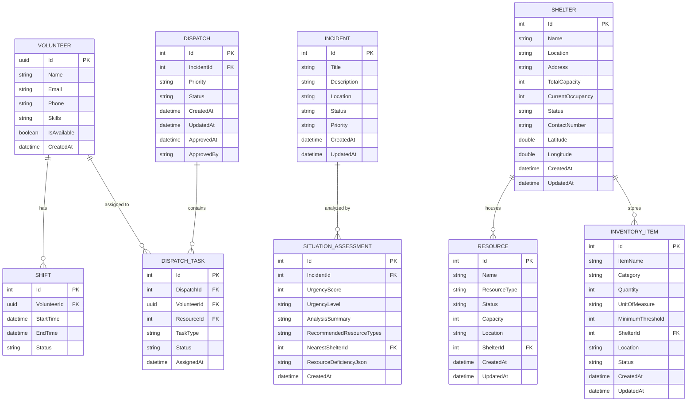

# Database Schema Baseline & ER Diagram
**Shared Task Lead**: Student 2 (Resource, Shelter & Inventory Management)

## Overview
This document specifies the PostgreSQL database schema baseline and Entity-Relationship (ER) model for the Emergency Resource Coordination Platform (ERCP). It highlights Student 2's ownership slice (**Resources**, **Shelters**, **InventoryItems**, and **SituationAssessments**) and shows how all components integrate.

## Mermaid ER Diagram

## Entities Owned by Student 2
1. **Shelters**: Tracks physical evacuation facilities, contact details, total capacity, current occupancy, and operational status (`Active`, `Full`, `Inactive`).
2. **Resources**: Tracks emergency vehicles, generators, trauma kits, and machinery. Includes real-time availability status (`Available`, `Dispatched`, `Maintenance`, `Reserved`) and location links to shelters.
3. **InventoryItems**: Tracks medical supplies, rations, water, and power equipment. Enforces automated low-stock detection (`InStock`, `LowStock`, `OutOfStock`) based on `MinimumThreshold`.
4. **SituationAssessments**: Stores the structured output and workflow audit trace produced by the **Situation Analysis AI Agent**.

## Audit & Integrity Constraints
- Audit fields (`CreatedAt`, `UpdatedAt`) maintained on all tables.
- Foreign Key constraints with `ON DELETE SET NULL` for shelter-resource/inventory relationships to prevent cascading loss of physical assets upon shelter status changes.
