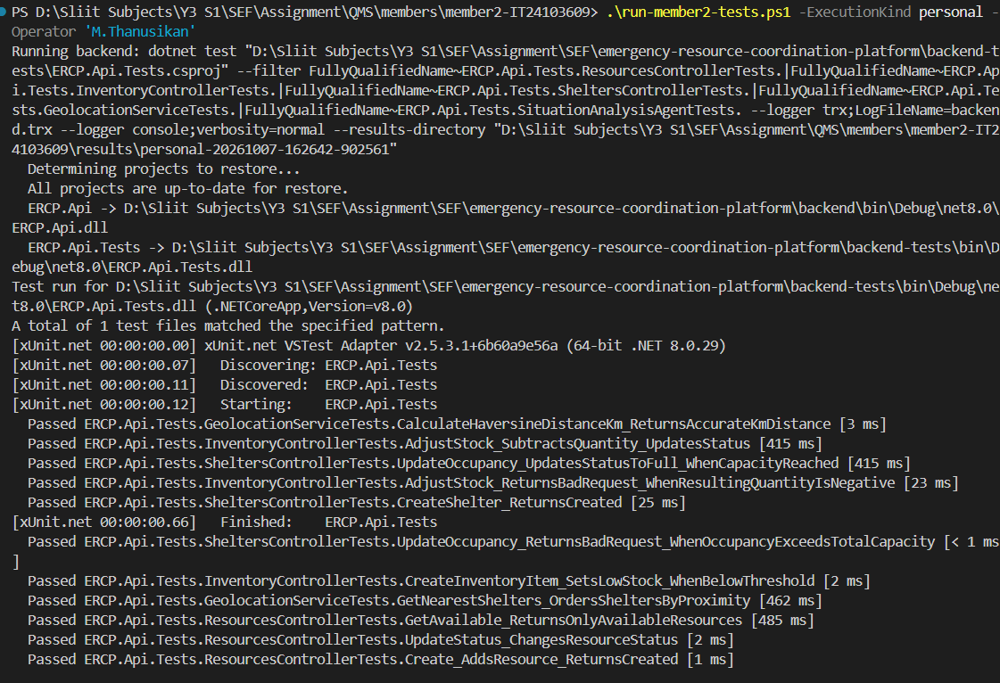
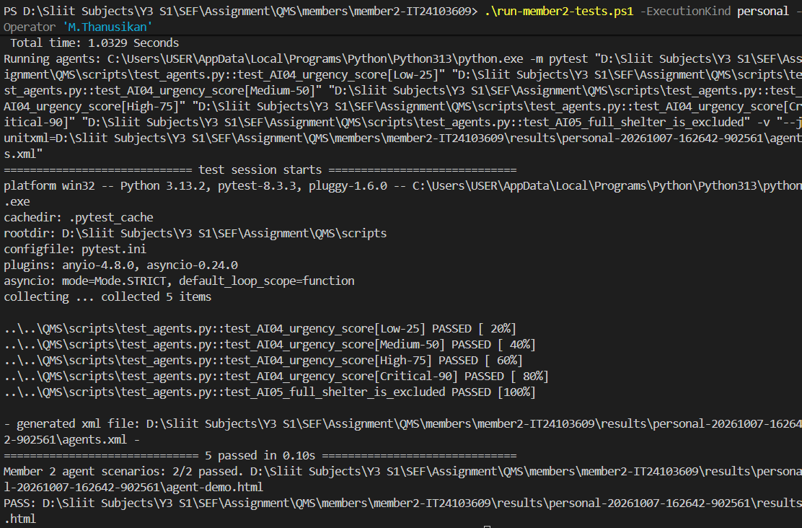

# M.Thanusikan / IT24103609 personal execution evidence

Started: 2026-10-07T16:26:42.902996+05:30. Declared operator: M.Thanusikan.

Raw reports confirm 12 backend and 5 agent tests passed, with no failures or skips. Two agent demonstration scenarios also passed.

The two screenshots were supplied on 7 October 2026 and preserved unchanged. They show terminal execution, not browser captures of results.html or agent-demo.html. Those generated HTML reports and their JSON inputs/outputs are included in the same folder.

Own-word explanations and a changed-input exercise remain pending. These are reruns of existing cases and do not increase the group totals.

